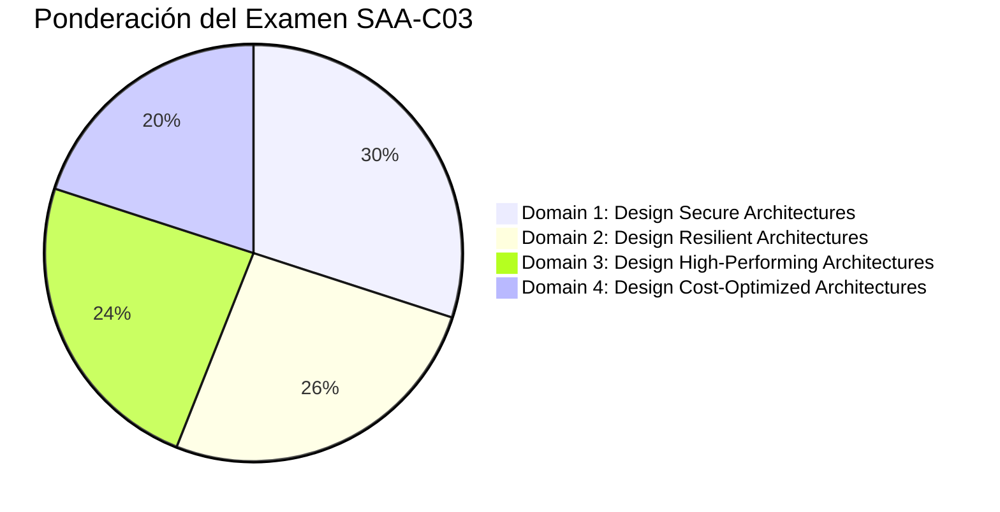

# ☁️ AWS Certified Solutions Architect – Associate (SAA-C03)
## Repositorio Maestro Consolidado de Preparación Intensiva (Plan 4 Semanas)

Bienvenido a tu hub consolidado de estudio para el examen **AWS Certified Solutions Architect – Associate (SAA-C03)**. Este repositorio sintetiza lo mejor de las fuentes de referencia más recomendadas de la comunidad (Adrian Cantrill, Vicjor, Chathuranga VKD, Rushabh Shah, SV222, Weder96 y el **Handbook Maestro SAA-C03 de 119 Servicios**), eliminando duplicidades y estructurado para una preparación rigurosa y directa al grano.

---

## 📊 Ficha Técnica del Examen SAA-C03

| Parámetro | Detalle |
| :--- | :--- |
| **Código del Examen** | SAA-C03 |
| **Nivel** | Associate |
| **Duración** | 130 minutos |
| **Formato** | 65 preguntas (Opción múltiple y respuesta múltiple) |
| **Puntaje de aprobación** | 720 / 1000 (Escala 100 - 1000) |
| **Preguntas no puntuadas** | 15 preguntas piloto no identificadas (no suman ni restan) |
| **Costo** | $150 USD |
| **Idioma** | Disponible en Español e Inglés (+30 min extra con ESL accommodation si tu idioma nativo no es inglés) |

### Dominios Oficiales y Ponderación:



---

## 🗺️ Mapa de Contenidos del Repositorio

- [**📘 Handbook de Servicios AWS SAA-C03 (119 Servicios en 16 Categorías) (`handbook/`)**](handbook/README.md) 🌟 *(¡Novedad!)*
  - Catálogo técnico modular bilingüe (ES / EN) extraído y estructurado a partir del handbook oficial de 299 páginas (`handbook.pdf` / `_sources/handbook/`).
  - Cada servicio incluye: **Qué es**, **Arquitectura**, **Seguridad**, **Casos de uso** y **🎯 Exam Tips & Triggers**.
  - Accede al [Índice Maestro del Handbook](handbook/README.md) o consulta directamente por categoría:
    - [01 - Analítica (Athena, Glue, EMR, Kinesis, Redshift...)](handbook/01-analytics.md)
    - [02 - Integración de Apps (SQS, SNS, EventBridge, Step Functions...)](handbook/02-application-integration.md)
    - [03 - Gestión de Costos (Budgets, Cost Explorer, CUR, Savings Plans...)](handbook/03-cost-management.md)
    - [04 - Cómputo (EC2, Auto Scaling, Elastic Beanstalk, Batch...)](handbook/04-compute.md)
    - [05 - Contenedores (ECS, EKS, ECR, Anywhere, Distro...)](handbook/05-containers.md)
    - [06 - Bases de Datos (RDS, Aurora, DynamoDB, ElastiCache, QLDB...)](handbook/06-databases.md)
    - [07 - Herramientas Dev (X-Ray...)](handbook/07-developer-tools.md)
    - [08 - Front-End & Móvil (API Gateway, Amplify, Pinpoint...)](handbook/08-frontend-mobile.md)
    - [09 - Machine Learning (Rekognition, Transcribe, Polly, Comprehend, Kendra...)](handbook/09-machine-learning.md)
    - [10 - Gobernanza (CloudTrail, CloudWatch, Config, Organizations, Control Tower...)](handbook/10-management-governance.md)
    - [11 - Media Services (Elastic Transcoder...)](handbook/11-media-services.md)
    - [12 - Migración y Transferencia (DMS, MGN, DataSync, Snow Family...)](handbook/12-migration-transfer.md)
    - [13 - Redes y Conectividad (VPC, Route 53, CloudFront, Transit Gateway, ELB...)](handbook/13-networking-content-delivery.md)
    - [14 - Seguridad y Cifrado (IAM, KMS, WAF, Shield, GuardDuty, Macie, Secrets...)](handbook/14-security-identity-compliance.md)
    - [15 - Serverless (Lambda, Fargate...)](handbook/15-serverless.md)
    - [16 - Almacenamiento (S3, EBS, EFS, FSx, Storage Gateway, Backup...)](handbook/16-storage.md)
- [**Portal de Aprendizaje con Desbloqueo Progresivo (`portal/`)**](portal/index.html) 🚀
  - **URL Pública (GitHub Pages)**: 👉 [**https://aletrinak.github.io/aws-saa-c03-study-platform/**](https://aletrinak.github.io/aws-saa-c03-study-platform/)
  - **Simulador de Exámenes Online**: 👉 [**https://aletrinak.github.io/aws-saa-c03-study-platform/simulator/**](https://aletrinak.github.io/aws-saa-c03-study-platform/simulator/)
  - Aplicación web que te guía día por día: **Lees el material -> Rindes el examen de validación (>= 72%) -> Se desbloquea el siguiente día**.
  - Guarda tu progreso en memoria local (`localStorage`), con barra de avance e insignias de días completados.
  - Para abrirlo localmente: Ejecuta `./start-portal.ps1` o doble clic en `start-portal.bat` (o abre `http://localhost:5500`).
- [**Guías Teóricas por Dominio (`study-guide/`)**](study-guide/)
  - [Dominio 1: Diseñar Arquitecturas Seguras (30%)](study-guide/domain-1-secure-architectures/README.md)
  - [Dominio 2: Diseñar Arquitecturas Resilientes (26%)](study-guide/domain-2-resilient-architectures/README.md)
  - [Dominio 3: Diseñar Arquitecturas de Alto Rendimiento (24%)](study-guide/domain-3-high-performing-architectures/README.md)
  - [Dominio 4: Diseñar Arquitecturas Optimizadas en Costos (20%)](study-guide/domain-4-cost-optimized-architectures/README.md)
- [**Hojas de Referencia y Matrices de Decisión (`cheat-sheets/`)**](cheat-sheets/)
  - [Disparadores y Palabras Clave del Examen](cheat-sheets/exam-keywords-triggers.md)
  - [Matriz de Decisión: Almacenamiento (S3 vs EBS vs EFS vs FSx)](cheat-sheets/storage-comparison.md)
  - [Matriz de Decisión: Bases de Datos (RDS vs Aurora vs DynamoDB vs Redshift)](cheat-sheets/database-decision-matrix.md)
  - [Hoja de Redes: VPC, Peering, Transit Gateway, Direct Connect y PrivateLink](cheat-sheets/networking-cheat-sheet.md)
  - [Desacoplamiento y Mensajería: SQS vs SNS vs Kinesis vs EventBridge](cheat-sheets/messaging-decoupling.md)
- [**Simulador Interactivo Web (`simulator/`)**](simulator/index.html)
  - Abre [`simulator/index.html`](simulator/index.html) para simulacros globales con temporizador de 130 minutos y revisión.
- [**Banco de Preguntas Explicadas y Flashcards (`practice-exams/`)**](practice-exams/)
  - [Flashcards de Memoria Activa](practice-exams/flashcards.md)
  - [Banco de Escenarios con Justificación Técnica](practice-exams/scenario-questions-bank.md)
- [**Laboratorios y Arquitectura Práctica (`hands-on-labs/`)**](hands-on-labs/)
  - [01 - VPC y Redes Seguras](hands-on-labs/01-vpc-networking/)

---

## 📅 Plan Intensivo de 4 Semanas (Roadmap de Estudio)

```text
SEMANA 1 ──► Seguridad, Identidad y Redes Base (Dominio 1 - 30%)
SEMANA 2 ──► Cómputo, Resiliencia y Alta Disponibilidad (Dominio 2 - 26%)
SEMANA 3 ──► Almacenamiento Profundo, Bases de Datos y Rendimiento (Dominio 3 - 24%)
SEMANA 4 ──► Costos (Dominio 4 - 20%), Redes Híbridas, Simulador y Exámenes
```

### 🗓️ Semana 1: Seguridad, Identidad, Gobernanza y Redes Base (Dominio 1 - 30%)
*Meta: Dominar el dominio con mayor peso del examen.*
- **Día 1**: IAM (Usuarios, Grupos, Roles, Instance Profiles, Políticas gestionadas vs inline, Evaluación de políticas `Deny > Allow`). 📖 *Handbook:* [`14-security-identity-compliance.md`](handbook/14-security-identity-compliance.md#aws-identity-and-access-management-iam)
- **Día 2**: AWS Organizations, SCP (Service Control Policies), Control Tower, AWS IAM Identity Center (SSO). 📖 *Handbook:* [`10-management-governance.md`](handbook/10-management-governance.md#aws-organizations)
- **Día 3**: Cifrado y Claves: AWS KMS (SSE-S3, SSE-KMS, SSE-C, Claves Simétricas vs Asimétricas, Rotación, Políticas de clave), CloudHSM, AWS Secrets Manager vs SSM Parameter Store. 📖 *Handbook:* [`14-security-identity-compliance.md`](handbook/14-security-identity-compliance.md#aws-key-management-service-aws-kms)
- **Día 4**: VPC Core: Subnets públicas/privadas, Route Tables, Internet Gateway (IGW), NAT Gateway vs NAT Instance, Security Groups (stateful) vs NACLs (stateless). 📖 *Handbook:* [`13-networking-content-delivery.md`](handbook/13-networking-content-delivery.md#amazon-vpc)
- **Día 5**: Seguridad perimetral y detección: AWS WAF, AWS Shield Standard/Advanced, AWS GuardDuty, AWS Macie, AWS Inspector, VPC Flow Logs. 📖 *Handbook:* [`14-security-identity-compliance.md`](handbook/14-security-identity-compliance.md)
- **Día 6-7**: Repaso de Semana 1 en `cheat-sheets/exam-keywords-triggers.md` y resolver 40 preguntas del Dominio 1 en el [Simulador](simulator/index.html).

### 🗓️ Semana 2: Cómputo, Resiliencia y Desacoplamiento (Dominio 2 - 26%)
*Meta: Diseñar arquitecturas tolerantes a fallos y elásticas.*
- **Día 8**: EC2 y opciones de compra (On-Demand, Spot, Savings Plans, Reserved, Dedicated Hosts). Auto Scaling Groups (ASG): Launch Templates, Scaling Policies (Target Tracking, Step, Simple), Lifecycle Hooks. 📖 *Handbook:* [`04-compute.md`](handbook/04-compute.md) y [`05-containers.md`](handbook/05-containers.md)
- **Día 9**: Elastic Load Balancing: ALB (Layer 7, path/host routing) vs NLB (Layer 4, ultra-low latency, IP estática) vs GWLB (inspección de tráfico). Session Stickiness, SSL Offloading/SNI. 📖 *Handbook:* [`13-networking-content-delivery.md`](handbook/13-networking-content-delivery.md#elastic-load-balancing-elb)
- **Día 10**: Route 53: Políticas de enrutamiento (Simple, Weighted, Latency, Failover, Geolocation, Geoproximity, Multi-value answer), Health checks. 📖 *Handbook:* [`13-networking-content-delivery.md`](handbook/13-networking-content-delivery.md#amazon-route-53)
- **Día 11**: Estrategias de Disaster Recovery (DR): Backup & Restore (mayor RTO/RPO) -> Pilot Light -> Warm Standby -> Multi-Site Active/Active (menor RTO/RPO). 📖 *Handbook:* [`16-storage.md`](handbook/16-storage.md#aws-backup)
- **Día 12**: Desacoplamiento y Mensajería: Amazon SQS (Standard vs FIFO, Visibilidad, Dead Letter Queues, Long Polling), Amazon SNS (Fan-out pattern, Message Filtering), Amazon EventBridge, Step Functions. 📖 *Handbook:* [`02-application-integration.md`](handbook/02-application-integration.md)
- **Día 13-14**: Laboratorio de ASG + ALB, Repaso de [`messaging-decoupling.md`](cheat-sheets/messaging-decoupling.md) y test de 40 preguntas del Dominio 2.

### 🗓️ Semana 3: Almacenamiento, Bases de Datos y Alto Rendimiento (Dominio 3 - 24%)
*Meta: Elegir el almacenamiento y la base de datos óptima para cada caso de uso.*
- **Día 15**: Amazon S3 en profundidad: Clases (Standard, Infrequent Access, Glacier Instant/Flexible/Deep Archive, Intelligent-Tiering), Ciclos de vida, Versionado, S3 Object Lock, S3 Replication (CRR/SRR), S3 Transfer Acceleration. 📖 *Handbook:* [`16-storage.md`](handbook/16-storage.md#amazon-s3)
- **Día 16**: Bloque y Archivos: EBS (gp3, io2, sc1, st1, Multi-Attach), EFS (ReadWriteMany para Linux, POSIX), Amazon FSx (Lustre para HPC/ML, Windows File Server, NetApp ONTAP, OpenZFS). 📖 *Handbook:* [`16-storage.md`](handbook/16-storage.md)
- **Día 17**: Bases de Datos Relacionales: Amazon RDS (Multi-AZ para HA vs Read Replicas para lectura y performance), Amazon Aurora (Storage engine compartido, Aurora Serverless, Global Database, hasta 15 réplicas). 📖 *Handbook:* [`06-databases.md`](handbook/06-databases.md#amazon-aurora)
- **Día 18**: NoSQL & Caching: Amazon DynamoDB (Partition/Sort keys, DAX para microsegundos, Global Tables, Streams, TTL, WCU/RCU), Amazon ElastiCache (Redis vs Memcached). 📖 *Handbook:* [`06-databases.md`](handbook/06-databases.md#amazon-dynamodb)
- **Día 19**: Redes de Entrega Global y Serverless: Amazon CloudFront (OAI/OAC para S3, Caching) vs AWS Global Accelerator. Cómputo serverless con Lambda y Fargate. 📖 *Handbook:* [`15-serverless.md`](handbook/15-serverless.md) y [`01-analytics.md`](handbook/01-analytics.md)
- **Día 20-21**: Repaso de matrices [`storage-comparison.md`](cheat-sheets/storage-comparison.md) y [`database-decision-matrix.md`](cheat-sheets/database-decision-matrix.md). 50 preguntas de práctica.

### 🗓️ Semana 4: Costos (Dominio 4 - 20%), Conectividad Híbrida y Simulaciones Finales
*Meta: Afinar patrones de costo, redes complejas y rendir simulacros con cronómetro.*
- **Día 22**: Dominio 4 (Costos): Compute Optimizer, Cost Explorer, AWS Budgets, VPC Gateway Endpoints, Data Transfer Cost Optimization. 📖 *Handbook:* [`03-cost-management.md`](handbook/03-cost-management.md)
- **Día 23**: Redes avanzadas e híbridas: VPC Peering vs AWS Transit Gateway, AWS PrivateLink, AWS Direct Connect (DX) vs Site-to-Site VPN, Storage Gateway. 📖 *Handbook:* [`13-networking-content-delivery.md`](handbook/13-networking-content-delivery.md#aws-transit-gateway) y [`16-storage.md`](handbook/16-storage.md#aws-storage-gateway)
- **Día 24**: Migración, Analítica y Servicios Especializados: AWS DMS, DataSync, Snow Family, Athena, Redshift, Machine Learning (Rekognition, Transcribe, Kendra). 📖 *Handbook:* [`12-migration-transfer.md`](handbook/12-migration-transfer.md), [`01-analytics.md`](handbook/01-analytics.md), [`09-machine-learning.md`](handbook/09-machine-learning.md)
- **Día 25**: Repaso completo de [Palabras Clave y Disparadores](cheat-sheets/exam-keywords-triggers.md), [Flashcards](practice-exams/flashcards.md) y sección **Exam Tips** del [Handbook Completo](handbook/README.md).
- **Día 26**: Simulacro Completo 1 (65 preguntas, 130 minutos) usando el [Simulador](simulator/index.html). Análisis de fallas.
- **Día 27**: Simulacro Completo 2 (65 preguntas) + repaso del [Banco de Escenarios](practice-exams/scenario-questions-bank.md).
- **Día 28**: Descanso ligero, repaso de tablas comparativas y checklist final de examen.

---

## 🎯 Consejos de Oro para el Examen

1. **Lee primero la última frase de la pregunta**: Identifica el requisito central antes de leer el enunciado:
   - *"with the LEAST operational overhead"* -> Busca soluciones Serverless / Managed (ej. Athena, Lambda, Aurora Serverless).
   - *"MOST cost-effective"* -> Busca Spot instances, S3 Intelligent-Tiering, Gateway Endpoints.
   - *"sub-millisecond latency"* -> Busca DynamoDB DAX, ElastiCache, EBS io2 Block Express.
   - *"without traversing the internet"* -> VPC Endpoints, Direct Connect, PrivateLink.
2. **Descarta opciones técnicamente imposibles**: Respuestas que combinan servicios incompatibles (ej. EFS en Windows, Gateway Endpoint para SQS, Multi-Attach en volúmenes gp3).
3. **Cuidado con la trampa de Multi-AZ vs Read Replicas**:
   - Multi-AZ = **Disponibilidad y Failover sincrónico** (no escala lecturas).
   - Read Replicas = **Rendimiento de Lectura asincrónico** (no es failover automático por defecto en RDS tradicional).


---

## 🌐 Demo Online & Despliegue

- **GitHub Pages:** Este repositorio incluye un workflow en [`.github/workflows/pages.yml`](.github/workflows/pages.yml) que publica automáticamente el portal y el simulador en GitHub Pages al hacer push a `main`.
- **Ejecución local:**
  - En Windows: ejecutá `start-portal.bat` o `start-portal.ps1`.
  - Con Docker: `docker build -t aws-saa-portal . && docker run -p 8080:80 aws-saa-portal`

---

## 📜 Licencia y Disclaimer

- El código fuente de la plataforma se distribuye bajo licencia [MIT](LICENSE).
- Este es un proyecto educativo comunitario sin afiliación oficial con Amazon Web Services (AWS). Todas las marcas comerciales, nombres de servicios y logotipos pertenecen a sus respectivos propietarios.
