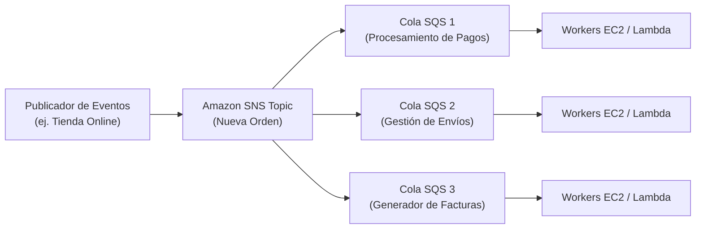

# 📬 Desacoplamiento y Mensajería AWS (Messaging & Decoupling)

Las arquitecturas modernas en la nube deben desacoplar sus componentes para evitar fallos en cascada y absorber picos de tráfico. El examen evalúa con precisión cuándo usar cada servicio de mensajería.

---

## 🧭 Cuadro Comparativo Rápido

| Servicio | Modelo de Comunicación | Consumidores | Retención / Relectura | Orden y Duplicados |
| :--- | :--- | :--- | :--- | :--- |
| **Amazon SQS** | **Pull** (Los consumidores consultan la cola activamente) | 1 a 1 (un mensaje es procesado y eliminado por un solo consumidor) | Hasta 14 días. El mensaje se **elimina** tras procesarse. | • Standard: Al menos una vez (puede duplicar), mejor esfuerzo.<br>• FIFO: Exactamente una vez, orden estricto. |
| **Amazon SNS** | **Push** (El servicio empuja el evento de inmediato) | **Pub/Sub (1 a Muchos)**: Fan-out hacia múltiples colas SQS, Lambdas, HTTP, SMS. | **Sin retención** (si no hay suscriptores disponibles, el mensaje se descarta). | Publicación inmediata. Soporta SNS FIFO para orden en colas SQS FIFO. |
| **Amazon Kinesis Data Streams** | **Pull** (Varios consumidores leen del stream concurrentemente) | Múltiples aplicaciones analíticas procesan el mismo flujo de datos a distintas velocidades. | **24 horas a 365 días**. Los datos permanecen en el stream y pueden re-leerse. | Orden estricto garantizado dentro de cada **Shard** usando `PartitionKey`. |
| **Amazon Kinesis Firehose** | **Ingesta y Entrega Automática** (Serverless) | Entrega continua hacia **S3, Redshift, OpenSearch, Splunk**. | En tránsito (Buffer por tiempo: 60-900s o tamaño: 1-128MB). | Near-real-time. Realiza conversión de formato a Parquet/ORC sobre la marcha. |
| **Amazon EventBridge** | **Bus de Eventos Serverless (Push)** | Enrutamiento inteligente a más de 20 destinos AWS y partners SaaS externos. | Permite **Archive & Replay** (archivar eventos y reproducirlos ante fallos). | Enrutamiento basado en filtros y reglas JSON avanzadas. |
| **Amazon MQ** | **Broker de Mensajería Tradicional** | Protocolos heredados: **AMQP, MQTT, STOMP, OpenWire, JMS** (ActiveMQ / RabbitMQ). | Según motor | **Migración "Lift and Shift"** de aplicaciones empresariales existentes sin reescribir código. |

---

## 🐇 Amazon SQS: Puntos Vitales de Examen

### 1. Parámetros Críticos
- **Visibility Timeout (Tiempo de Visibilidad)**:
  - Tiempo durante el cual un mensaje se vuelve **invisible** para otros consumidores mientras un worker lo procesa.
  - Valor por defecto: **30 segundos** (configurable de 0 segundos a 12 horas).
  - *Pregunta típica de examen*: "El consumidor tarda 2 minutos en procesar el mensaje y otros consumidores lo toman duplicado". Solución: Extender el timeout de visibilidad usando la API `ChangeMessageVisibility` o aumentar el timeout base de la cola.
- **Dead Letter Queue (DLQ)**:
  - Si un mensaje falla tras un número determinado de intentos (`maxReceiveCount`), se envía a la DLQ para análisis sin bloquear la cola principal.
- **Long Polling (`WaitTimeSeconds: 1 a 20`)**:
  - Espera hasta 20 segundos a que llegue un mensaje antes de responder.
  - **Reduce costos drásticamente** (menos llamadas API vacías) y disminuye falsas respuestas vacías.
- **Retención de Mensajes**: De 1 minuto a 14 días (por defecto: 4 días).

### 2. SQS Standard vs SQS FIFO

```text
┌──────────────────────────────┬──────────────────────────────┐
│         SQS Standard         │           SQS FIFO           │
├──────────────────────────────┼──────────────────────────────┤
│ Rendimiento ilimitado        │ 300 msg/s (3,000 con batching│
│ Entrega al menos una vez     │ Entrega exactamente una vez  │
│ Mejor esfuerzo de ordenación │ Orden estricto (First-In)    │
│ Nombre: mi-cola              │ Nombre: mi-cola.fifo         │
│ No requiere IDs especiales   │ Requiere Message Group ID    │
│                              │ y Message Deduplication ID   │
└──────────────────────────────┴──────────────────────────────┘
```

---

## 📢 Patrón de Arquitectura: Fan-Out (SNS + SQS)

Este es uno de los patrones más recurrentes del examen SAA-C03:



### Ventajas evaluadas en el examen:
1. **Desacoplamiento total**: El publicador solo envía el evento una sola vez a SNS.
2. **Filtrado de Mensajes (Message Filtering)**: Si una cola solo necesita órdenes de cierto país o monto, se configura una política de filtrado en SNS sin necesidad de que la aplicación procese y descarte mensajes.
3. **Persistencia y tolerancia a fallos**: Si los workers de facturas están caídos, los mensajes quedan seguros en la cola SQS 3 sin afectar a pagos ni envíos.
