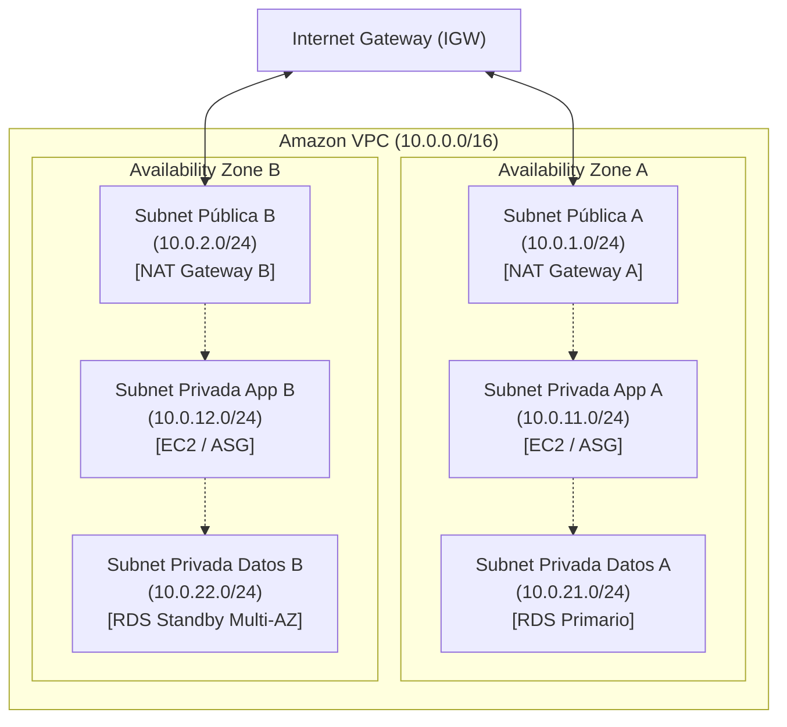

# 🧪 Laboratorio 1: Arquitectura de Red VPC Multi-AZ de 3 Capas

Este laboratorio práctico implementa la base sobre la cual descansan el 80% de las arquitecturas recomendadas en el examen SAA-C03: una **VPC de 3 capas** (Web, App y Datos) distribuida en **2 Zonas de Disponibilidad (Multi-AZ)** con alta disponibilidad y aislamiento estricto.

---

## 🏛️ Diagrama de la Arquitectura



---

## 📐 Especificación de Red

| Capa | Subnet AZ-A | Subnet AZ-B | Destino de Ruta 0.0.0.0/0 | Propósito |
| :--- | :--- | :--- | :--- | :--- |
| **Capa 1: Pública (Web/ALB)** | `10.0.1.0/24` | `10.0.2.0/24` | `Internet Gateway (IGW)` | Aloja ALBs públicos y NAT Gateways con IPs elásticas. |
| **Capa 2: Privada (App/Compute)** | `10.0.11.0/24` | `10.0.12.0/24` | `NAT Gateway` de su respectiva AZ | Aloja instancias EC2, Auto Scaling Groups y microservicios. |
| **Capa 3: Privada (Database)** | `10.0.21.0/24` | `10.0.22.0/24` | **Sin salida a internet (Aislada)** | Aloja clústeres de base de datos RDS / Aurora sin exposición a la red. |

---

## 📄 Plantilla CloudFormation Automatizada

Guarda el siguiente código como `vpc-3tier.yaml` para desplegar el laboratorio en AWS CloudFormation:

```yaml
AWSTemplateFormatVersion: '2010-09-09'
Description: 'SAA-C03 Lab 1: Multi-AZ 3-Tier Production Ready VPC'

Parameters:
  VpcCIDR:
    Type: String
    Default: '10.0.0.0/16'
    Description: CIDR block para la VPC

Resources:
  # 1. VPC Principal
  ProductionVPC:
    Type: AWS::EC2::VPC
    Properties:
      CidrBlock: !Ref VpcCIDR
      EnableDnsHostnames: true
      EnableDnsSupport: true
      Tags:
        - Key: Name
          Value: SAA-C03-Lab1-VPC

  # 2. Internet Gateway
  InternetGateway:
    Type: AWS::EC2::InternetGateway
    Properties:
      Tags:
        - Key: Name
          Value: SAA-C03-Lab1-IGW

  AttachIGW:
    Type: AWS::EC2::VPCGatewayAttachment
    Properties:
      VpcId: !Ref ProductionVPC
      InternetGatewayId: !Ref InternetGateway

  # 3. Subnets Públicas
  PublicSubnetA:
    Type: AWS::EC2::Subnet
    Properties:
      VpcId: !Ref ProductionVPC
      CidrBlock: '10.0.1.0/24'
      AvailabilityZone: !Select [0, !GetAZs '']
      MapPublicIpOnLaunch: true
      Tags:
        - Key: Name
          Value: Public-Subnet-AZ-A

  PublicSubnetB:
    Type: AWS::EC2::Subnet
    Properties:
      VpcId: !Ref ProductionVPC
      CidrBlock: '10.0.2.0/24'
      AvailabilityZone: !Select [1, !GetAZs '']
      MapPublicIpOnLaunch: true
      Tags:
        - Key: Name
          Value: Public-Subnet-AZ-B

  # 4. Route Table Pública
  PublicRouteTable:
    Type: AWS::EC2::RouteTable
    Properties:
      VpcId: !Ref ProductionVPC
      Tags:
        - Key: Name
          Value: Public-Route-Table

  DefaultPublicRoute:
    Type: AWS::EC2::Route
    DependsOn: AttachIGW
    Properties:
      RouteTableId: !Ref PublicRouteTable
      DestinationCidrBlock: '0.0.0.0/0'
      GatewayId: !Ref InternetGateway

  SubnetRouteAssocA:
    Type: AWS::EC2::SubnetRouteTableAssociation
    Properties:
      SubnetId: !Ref PublicSubnetA
      RouteTableId: !Ref PublicRouteTable

  SubnetRouteAssocB:
    Type: AWS::EC2::SubnetRouteTableAssociation
    Properties:
      SubnetId: !Ref PublicSubnetB
      RouteTableId: !Ref PublicRouteTable

  # 5. Gateway VPC Endpoint para Amazon S3 (Optimización de costos 100% gratuita)
  S3GatewayEndpoint:
    Type: AWS::EC2::VPCEndpoint
    Properties:
      VpcId: !Ref ProductionVPC
      ServiceName: !Sub 'com.amazonaws.${AWS::Region}.s3'
      VpcEndpointType: Gateway
      RouteTableIds:
        - !Ref PublicRouteTable

Outputs:
  VpcId:
    Description: ID de la VPC creada
    Value: !Ref ProductionVPC
  PublicSubnets:
    Description: Subnets públicas
    Value: !Join [",", [!Ref PublicSubnetA, !Ref PublicSubnetB]]
```

---

## 🎯 Preguntas de Examen Vinculadas a este Laboratorio
1. *¿Por qué se requieren mínimo 2 Subnets en distintas AZs para desplegar un Application Load Balancer (ALB)?*  
   **R**: Porque el ALB necesita alta disponibilidad nativa y exige al menos dos subnets en zonas de disponibilidad diferentes para aprovisionar sus interfaces de red elásticas.
2. *¿Por qué la capa de base de datos no tiene una ruta 0.0.0.0/0 hacia un NAT Gateway?*  
   **R**: Por el principio de defensa en profundidad y aislamiento de red. Si la base de datos no necesita descargar parches directamente de internet (o usa repositorios privados), no debe tener ruta de salida externa.
