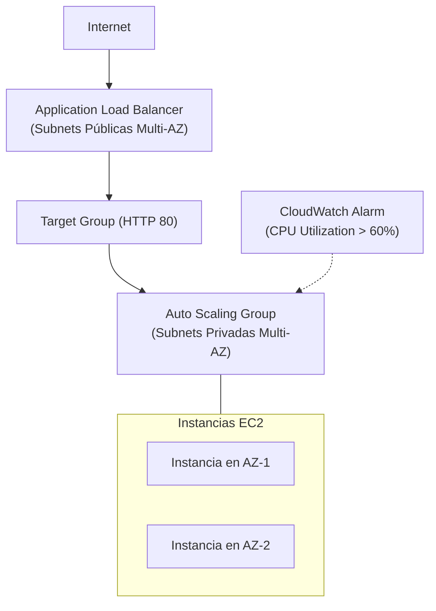

# 🧪 Laboratorio 2: Auto Scaling Group con Application Load Balancer

Este laboratorio práctico demuestra cómo desplegar una aplicación web stateless altamente disponible con escalado elástico ante demanda y balanceo de carga en Capa 7.

---

## 🏛️ Arquitectura del Laboratorio



---

## 📄 Plantilla CloudFormation Automatizada (`asg-alb.yaml`)

```yaml
AWSTemplateFormatVersion: '2010-09-09'
Description: 'SAA-C03 Lab 2: Highly Available ASG with ALB'

Parameters:
  VpcId:
    Type: AWS::EC2::VPC::Id
    Description: VPC donde desplegar el laboratorio
  PublicSubnets:
    Type: List<AWS::EC2::Subnet::Id>
    Description: Lista de al menos 2 Subnets públicas
  PrivateSubnets:
    Type: List<AWS::EC2::Subnet::Id>
    Description: Lista de al menos 2 Subnets privadas

Resources:
  # Security Group para el ALB
  ALBSecurityGroup:
    Type: AWS::EC2::SecurityGroup
    Properties:
      GroupDescription: 'Permitir HTTP desde Internet'
      VpcId: !Ref VpcId
      SecurityGroupIngress:
        - IpProtocol: tcp
          FromPort: 80
          ToPort: 80
          CidrIp: 0.0.0.0/0

  # Security Group para las instancias EC2 (Solo permite tráfico del ALB)
  InstanceSecurityGroup:
    Type: AWS::EC2::SecurityGroup
    Properties:
      GroupDescription: 'Permitir HTTP unicamente desde el Security Group del ALB'
      VpcId: !Ref VpcId
      SecurityGroupIngress:
        - IpProtocol: tcp
          FromPort: 80
          ToPort: 80
          SourceSecurityGroupId: !Ref ALBSecurityGroup

  # Application Load Balancer
  ApplicationLoadBalancer:
    Type: AWS::ElasticLoadBalancingV2::LoadBalancer
    Properties:
      Scheme: internet-facing
      Type: application
      Subnets: !Ref PublicSubnets
      SecurityGroups:
        - !Ref ALBSecurityGroup

  # Target Group con Health Checks
  ALBTargetGroup:
    Type: AWS::ElasticLoadBalancingV2::TargetGroup
    Properties:
      VpcId: !Ref VpcId
      Port: 80
      Protocol: HTTP
      TargetType: instance
      HealthCheckPath: /
      HealthCheckIntervalSeconds: 15
      HealthyThresholdCount: 2
      UnhealthyThresholdCount: 3

  ALBListener:
    Type: AWS::ElasticLoadBalancingV2::Listener
    Properties:
      LoadBalancerArn: !Ref ApplicationLoadBalancer
      Port: 80
      Protocol: HTTP
      DefaultActions:
        - Type: forward
          TargetGroupArn: !Ref ALBTargetGroup

  # Launch Template para las instancias EC2
  AppLaunchTemplate:
    Type: AWS::EC2::LaunchTemplate
    Properties:
      LaunchTemplateData:
        InstanceType: t3.micro
        SecurityGroupIds:
          - !Ref InstanceSecurityGroup
        UserData:
          Fn::Base64: !Sub |
            #!/bin/bash
            yum update -y
            yum install -y httpd
            systemctl start httpd
            systemctl enable httpd
            echo "<h1>Servidor Web Activo en AZ: $(ec2-metadata -z | cut -d ' ' -f 2)</h1>" > /var/www/html/index.html

  # Auto Scaling Group
  AppAutoScalingGroup:
    Type: AWS::AutoScaling::AutoScalingGroup
    Properties:
      VPCZoneIdentifier: !Ref PrivateSubnets
      LaunchTemplate:
        LaunchTemplateId: !Ref AppLaunchTemplate
        Version: !GetAtt AppLaunchTemplate.LatestVersionNumber
      MinSize: '2'
      MaxSize: '6'
      DesiredCapacity: '2'
      TargetGroupARNs:
        - !Ref ALBTargetGroup
      HealthCheckType: ELB
      HealthCheckGracePeriod: 300

  # Politica de Target Tracking: Mantener CPU al 50%
  ScalingPolicyCPU:
    Type: AWS::AutoScaling::ScalingPolicy
    Properties:
      AutoScalingGroupName: !Ref AppAutoScalingGroup
      PolicyType: TargetTrackingScaling
      TargetTrackingConfiguration:
        PredefinedMetricSpecification:
          PredefinedMetricType: ASGAverageCPUUtilization
        TargetValue: 50.0
```
