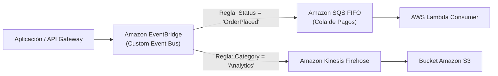

# 🧪 Laboratorio 3: Arquitectura Serverless Basada en Eventos (EventBridge + SQS + Lambda)

Este laboratorio implementa el patrón de desacoplamiento moderno mediante un bus de eventos en Amazon EventBridge que enruta eventos a colas SQS procesadas por funciones Lambda.

---

## 🏛️ Arquitectura del Laboratorio



---

## 📄 Plantilla CloudFormation (`serverless-event-driven.yaml`)

```yaml
AWSTemplateFormatVersion: '2010-09-09'
Description: 'SAA-C03 Lab 3: Event-Driven Serverless Pattern with EventBridge and SQS'

Resources:
  # 1. Custom EventBridge Bus
  OrdersEventBus:
    Type: AWS::Events::EventBus
    Properties:
      Name: OrdersBus

  # 2. Cola SQS para Pagos
  PaymentOrdersQueue:
    Type: AWS::SQS::Queue
    Properties:
      QueueName: payment-orders-queue
      VisibilityTimeout: 60
      MessageRetentionPeriod: 86400

  # 3. Politica para que EventBridge pueda enviar mensajes a la cola SQS
  QueuePolicy:
    Type: AWS::SQS::QueuePolicy
    Properties:
      Queues:
        - !Ref PaymentOrdersQueue
      PolicyDocument:
        Statement:
          - Effect: Allow
            Principal:
              Service: events.amazonaws.com
            Action: sqs:SendMessage
            Resource: !GetAtt PaymentOrdersQueue.Arn

  # 4. Regla en EventBridge para filtrar solo ordenes de pago
  PaymentRule:
    Type: AWS::Events::Rule
    Properties:
      EventBusName: !Ref OrdersEventBus
      EventPattern:
        source:
          - "ecommerce.orders"
        detail-type:
          - "OrderPlaced"
      Targets:
        - Arn: !GetAtt PaymentOrdersQueue.Arn
          Id: "PaymentQueueTarget"
```
