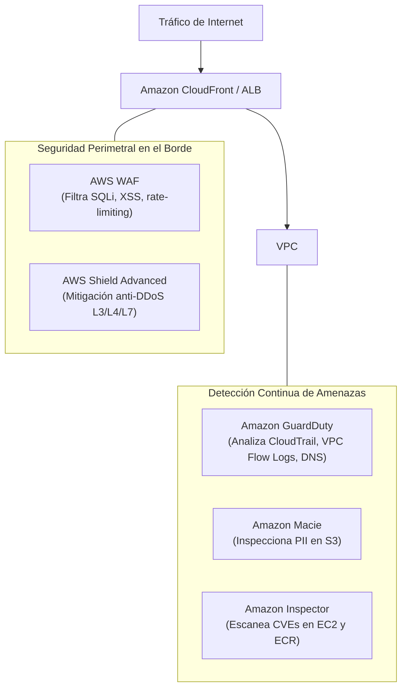

# 🛡️ Dominio 1: Diseñar Arquitecturas Seguras (30% del Examen)

El Dominio 1 representa la porción con mayor peso porcentual en el SAA-C03 (30%). Cubre control de acceso, protección de datos en reposo y tránsito, seguridad de red y gobernanza.

---

## 1. Identidad y Control de Acceso (IAM & AWS Organizations)

### Principio de Menor Privilegio (Least Privilege)
- Otorgar únicamente los permisos estrictamente necesarios para cumplir la tarea.
- **Root User**:
  - Utilizar únicamente para crear la cuenta, cambiar datos de facturación o cerrar la cuenta.
  - Bloquear con **MFA físico o virtual** de inmediato.
  - Nunca generar Access Keys para el usuario root.

### Componentes de IAM
- **Users**: Personas o servicios individuales.
- **Groups**: Agrupaciones de usuarios con políticas compartidas (los grupos NO pueden contener otros grupos).
- **Roles**: Identidades temporales asumidas por:
  - Servicios de AWS (ej. una instancia EC2 asume un rol mediante un **Instance Profile** para leer de S3 sin credenciales quemadas en código).
  - Usuarios federados (SAML 2.0, Active Directory, OIDC/Google/Facebook).
  - Usuarios de otras cuentas de AWS (**Cross-Account Access**).
- **Políticas IAM**: Documentos JSON con estructura:
  ```json
  {
    "Version": "2012-10-17",
    "Statement": [
      {
        "Sid": "AllowS3ReadOnly",
        "Effect": "Allow",
        "Action": ["s3:GetObject", "s3:ListBucket"],
        "Resource": [
          "arn:aws:s3:::mi-bucket-seguro",
          "arn:aws:s3:::mi-bucket-seguro/*"
        ],
        "Condition": {
          "IpAddress": { "aws:SourceIp": "203.0.113.0/24" }
        }
      }
    ]
  }
  ```

### Lógica de Evaluación de Políticas de AWS
1. Por defecto, todo acceso es **Deny implícito**.
2. Un **Allow explícito** concede acceso.
3. Un **Deny explícito siempre gana y anula cualquier Allow**.

### AWS Organizations & Service Control Policies (SCPs)
- Permite gestionar múltiples cuentas de AWS de forma centralizada con facturación consolidada.
- **SCPs (Service Control Policies)**:
  - Son **filtros de límites de permisos (guardrails)** a nivel de cuenta o Unidad Organizacional (OU).
  - **No conceden permisos por sí solas**; definen el máximo de permisos que las políticas IAM de las cuentas miembro pueden otorgar.
  - Aplican a todas las identidades de las cuentas miembro, **incluyendo el usuario Root de las cuentas miembro**.
  - **NO aplican a la cuenta de administración (Management Account)**.

---

## 2. Cifrado y Protección de Datos (KMS, CloudHSM, Secrets)

### AWS Key Management Service (KMS)
- Totalmente integrado con los servicios de AWS para cifrado en reposo.
- **Customer Master Keys (KMS Keys)**:
  - **AWS Owned Keys**: Gratuitas, gestionadas internamente por AWS (ej. `aws/s3`).
  - **AWS Managed Keys**: Creadas en tu cuenta por AWS, rotación automática cada 1 año.
  - **Customer Managed Keys (CMKs)**: Creadas por ti, control total sobre políticas de clave, rotación automática anual opcional o manual bajo demanda.
- **Envelope Encryption (Cifrado de Sobre)**:
  - KMS genera una **Data Key (DEK)** usando la KMS Key.
  - Los datos se cifran localmente con la clave de datos en texto plano.
  - La clave de datos se cifra con la KMS Key y se almacena junto al dato cifrado. La clave de datos en texto plano se purga de la memoria.

### Modos de Cifrado en Amazon S3:
1. **SSE-S3**: Claves gestionadas por AWS con AES-256. Habilitado por defecto en todos los buckets.
2. **SSE-KMS**: Claves gestionadas en AWS KMS. Aporta registro de auditoría en CloudTrail y control granular de acceso mediante políticas de clave.
3. **SSE-C**: El cliente provee su propia clave en cada llamada HTTPS (AWS nunca almacena la clave).
4. **Client-Side Encryption**: El cliente cifra los datos antes de enviarlos a S3.

### AWS Secrets Manager vs SSM Parameter Store
- **AWS Secrets Manager**:
  - Especializado en credenciales de bases de datos, claves API y tokens.
  - **Rotación automática nativa** de credenciales (integrado con RDS, DocumentDB y Redshift mediante funciones Lambda).
- **AWS Systems Manager Parameter Store**:
  - Almacén de configuración general y secretos (tipo jerárquico `/app/prod/db_url`).
  - Nivel estándar gratuito.
  - No cuenta con rotación automática nativa out-of-the-box como Secrets Manager.

---

## 3. Seguridad Perimetral, Detección y Monitoreo



- **AWS WAF**: Inspección capa 7 (HTTP/S). Reglas administradas de AWS contra SQL Injection, Cross-Site Scripting (XSS), bloqueo por país o limitación de tasa por IP.
- **AWS Shield**:
  - **Standard**: Protección automática gratuita contra ataques DDoS en capas 3 y 4 (SYN floods, UDP reflection).
  - **Advanced**: Protección DDoS 24/7 con el equipo SRT (Shield Response Team), protección de costos ante picos y cobertura L7.
- **Amazon GuardDuty**: Detección inteligente de anomalías mediante Machine Learning sin desplegar agentes. Detecta minería de criptomonedas, accesos no autorizados y llamadas API sospechosas.
- **Amazon Macie**: Descubrimiento y clasificación de datos confidenciales (tarjetas de crédito, pasaportes, PII) en Amazon S3 usando NLP y ML.
- **Amazon Inspector**: Escaneo automatizado de vulnerabilidades y exposición involuntaria a la red en instancias EC2, imágenes de contenedor en Amazon ECR y funciones Lambda.
