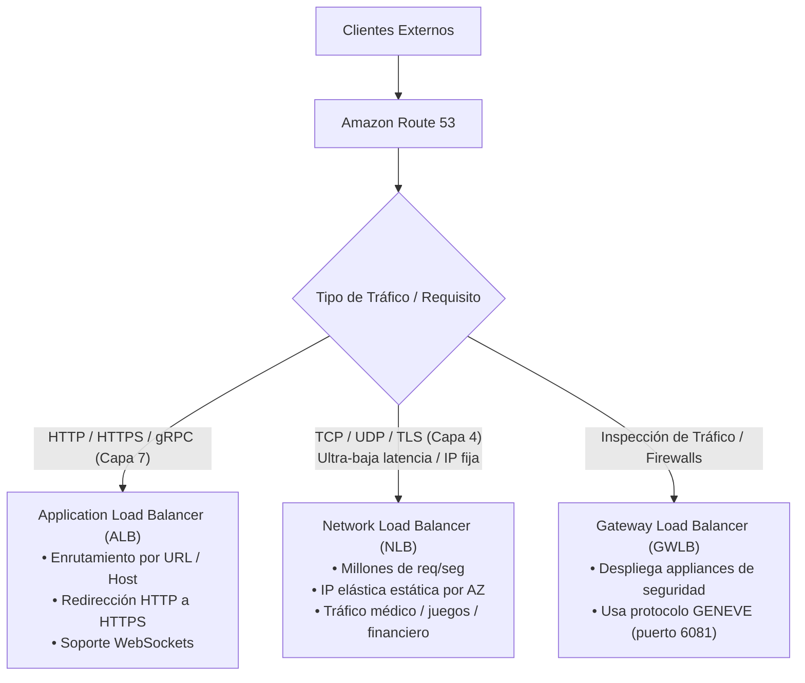

# 🏗️ Dominio 2: Diseñar Arquitecturas Resilientes (26% del Examen)

El Dominio 2 se enfoca en diseñar arquitecturas altamente disponibles, desacopladas, elásticas y tolerantes a fallos ante la pérdida de instancias, centros de datos completos (AZs) o regiones enteras.

---

## 1. Cómputo Elástico y Balanceo de Carga (ASG & ELB)

### Auto Scaling Groups (ASG)
- **Launch Template**: Configuración moderna que define la AMI, tipo de instancia, par de claves, Security Groups, volúmenes EBS e IAM Role. Soporta versionado y mezcla de instancias Spot y On-Demand.
- **Políticas de Escalado**:
  - **Target Tracking Scaling**: Mantener una métrica objetivo (ej. uso promedio de CPU al 50% o recuento de solicitudes de ALB por objetivo).
  - **Step Scaling**: Escalar en función del tamaño de la alarma (ej. si CPU > 70% sumar 1 instancia; si CPU > 85% sumar 3 instancias).
  - **Scheduled Scaling**: Anticipar picos predecibles de tráfico (ej. lunes a las 9:00 AM).
  - **Predictive Scaling**: Machine Learning analiza la demanda histórica y escala por adelantado.
- **Cooldown Period**: Periodo de enfriamiento (por defecto 300 segundos) para que las instancias recién iniciadas se estabilicen antes de evaluar nuevas alarmas.
- **Lifecycle Hooks**: Pausa el inicio o la terminación de instancias para ejecutar scripts personalizados (ej. descargar código, recopilar logs o vaciar colas de trabajo antes de destruir la máquina).

### Comparativa de Balanceadores de Carga (ELB)



- **Cross-Zone Load Balancing**:
  - En ALB está **habilitado por defecto y es gratuito**. Distribuye el tráfico equitativamente entre todos los targets en todas las AZs registradas.
  - En NLB está deshabilitado por defecto (si se habilita, aplica costo por transferencia inter-AZ).
- **Deregistration Delay (Connection Draining)**:
  - Tiempo de gracia (por defecto 300 segundos) para que las peticiones en vuelo finalicen antes de que el ELB desconecte y desregistre una instancia marcada como insalubre.

---

## 2. Enrutamiento Inteligente con Amazon Route 53

Route 53 es un servicio DNS altamente disponible (SLA 100%) y balanceador global de tráfico.

| Política de Enrutamiento | Cómo Funciona | Caso de Uso de Examen |
| :--- | :--- | :--- |
| **Simple Routing** | Un solo registro con una o más IPs devueltas en orden aleatorio. | Tráfico estándar sin comprobaciones de salud complejas. |
| **Weighted Routing** | Porcentajes de tráfico asignados a diferentes recursos (ej. 80% v1, 20% v2). | **Pruebas A/B y despliegues tipo Canary**. |
| **Latency Routing** | Dirige al usuario a la región de AWS que le ofrezca la menor latencia de red. | Aplicaciones globales orientadas al rendimiento del usuario. |
| **Failover Routing** | Envía tráfico al recurso primario y cambia automáticamente al secundario si falla el Health Check. | **Disaster Recovery Activo / Pasivo**. |
| **Geolocation Routing** | Enruta según la ubicación geográfica del cliente (por Continente o País). | Restricciones de contenido por derechos legales o localización de idioma. |
| **Geoproximity Routing** | Enruta según la proximidad geográfica calculada entre el usuario y el recurso usando un valor de "Bias" (sesgo). | Desviar tráfico geográfico gradualmente hacia otra región. |
| **Multi-Value Answer** | Devuelve hasta 8 registros saludables elegidos al azar con verificación de salud. | Balanceo DNS simple del lado del cliente. |

---

## 3. Estrategias de Recuperación ante Desastres (Disaster Recovery - DR)

Las preguntas de DR se basan en dos métricas fundamentales:
- **RPO (Recovery Point Objective)**: Cuánta pérdida de datos en el tiempo puede tolerar el negocio.
- **RTO (Recovery Time Objective)**: Cuánto tiempo de inactividad puede tolerar el negocio hasta restaurar la operatividad.

```text
[Menor Costo / Mayor RPO y RTO] ──────────────────────────► [Mayor Costo / Menor RPO y RTO (Near Zero)]

  Backup & Restore          Pilot Light              Warm Standby          Multi-Site Active/Active
┌──────────────────┐    ┌──────────────────┐     ┌──────────────────┐     ┌──────────────────────┐
│ Datos en S3/Glac.│    │ Base de datos    │     │ Versión reducida │     │ Ambientes completos  │
│ Infraestructura  │    │ replicada activa,│     │ de toda la app   │     │ activos en 2+        │
│ se levanta desde │    │ cómputo apagado  │     │ corriendo 24/7   │     │ regiones simultáneas │
│ cero tras fallo. │    │ (AMI / Templates)│     │ a mínima escala. │     │ con Route 53 y Global│
│ (Horas a días)   │    │ (Decenas de min.)│     │ (Minutos)        │     │ Databases (<1 seg)   │
└──────────────────┘    └──────────────────┘     └──────────────────┘     └──────────────────────┘
```
